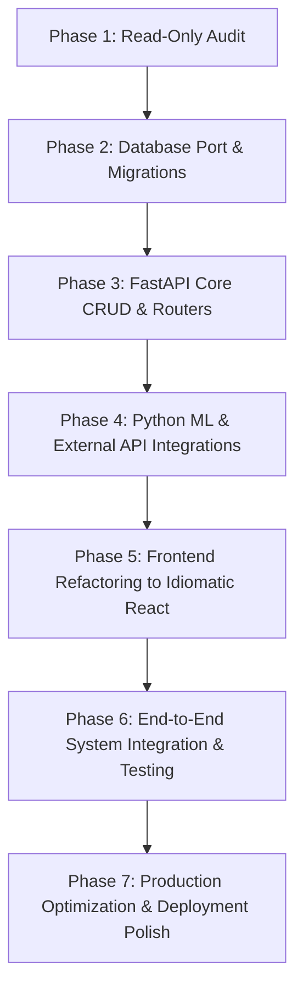

# BhoomiBandhu — Migration Status & Project Audit Report

**Audit Date:** 2026-10-18  
**Project Path:** `E:\BhoomiBandhu_React_Express_APIReady`  
**Current Phase:** Phase 1 (Complete Read-Only Audit)  
**Target Architecture:**  
- **Frontend:** React + JavaScript + JSX + Vite + React Router  
- **Backend:** Python FastAPI (replacing legacy Node.js Express)  
- **Database:** PostgreSQL (replacing legacy MySQL 8)  
- **AI/ML:** Python-based crop prediction (kNN / Scikit-learn / rules engine) & smart recommendations (Groq / Gemini AI advisor)

---

## 1. Executive Summary & Verified Setup

A comprehensive read-only audit of the repository was completed. The existing application is a functional full-stack system consisting of a React 18 single-page application (13 routes/pages) styled via CSS/pageStyles, an Express.js backend (`server.js`) connected to MySQL with proxying capabilities for OpenWeatherMap and Groq AI, and a reference MySQL schema (`database/bhoomibandhu_dbase.sql`).

A preliminary Python backend skeleton exists under `backend/` with a virtual environment (`backend\.venv`), FastAPI, SQLAlchemy, and Psycopg 3.

### Verified Environment & Setup Status
| Component | Verified State | Version / Details | Evidence / Notes |
| :--- | :--- | :--- | :--- |
| **Node.js & npm** | Installed & operational | Node >= 18 compatible | Dependencies present in root `node_modules` |
| **Root dependencies** | Installed | `package.json` | React 18.3.1, Vite 6.0.5, react-router-dom 6.28.0, express 4.19.2, mysql2 3.24.6 |
| **PostgreSQL Database** | Installed & operational | **PostgreSQL 18.6** on x86_64-windows | Database `bhoomi_bandhu` exists. Verified via `backend/test_db.py`. |
| **PostgreSQL Schema** | **Uninitialized (Empty)** | Tables: `[]` | `public` schema has 0 tables; MySQL dump has not yet been ported or run on Postgres. |
| **Python Virtual Environment** | Installed | `backend\.venv` | Python 3.12+ with virtualenv operational. |
| **Python Dependencies** | Installed | `pip list` verified | `fastapi 0.143.3`, `uvicorn 0.54.0`, `psycopg 3.3.6`, `psycopg-binary 3.3.6`, `SQLAlchemy 2.1.5`, `pydantic 2.14.1`, `python-dotenv 1.2.4`. Missing: `scikit-learn`, `numpy`, `httpx` / `aiohttp`. |
| **FastAPI Backend** | Minimal starter | `backend/main.py` | Contains only `/` (welcome) and `/health` endpoints. No DB models, routers, or AI logic yet. |
| **Express Backend** | Fully implemented | `server.js` | 13 endpoints handling MySQL persistence, Weather proxy, AI advisor proxy, and external schemes proxy. |

---

## 2. Frontend Feature Inventory

The frontend is located under `client/` and is built using React 18, Vite 6, and React Router 6. The 13 routes in `client/src/App.jsx` are currently implemented as a hybrid architecture: React components render the layout and load CSS, while interactivity and form submissions are driven by imperative DOM listeners imported from `client/src/legacy/*.js`.

### React Page & Component Inventory

| Page File | Route | Component Type & State | Legacy Script Hook | Features & Interactions | Status |
| :--- | :--- | :--- | :--- | :--- | :--- |
| [IndexPage.jsx](file:///e:/BhoomiBandhu_React_Express_APIReady/client/src/pages/IndexPage.jsx) | `/` | Functional React Component | `initCommon()`, `initIndex()` | Hero section, ticker tape, service navigation grid, dark/light theme switch. | Fully Functional (Hybrid) |
| [StoragePage.jsx](file:///e:/BhoomiBandhu_React_Express_APIReady/client/src/pages/StoragePage.jsx) | `/storage` | Functional React Component | `initStorage()` (`client/src/legacy/storage.js`) | Multi-tab UI (Home, Storage, Schemes, Booking, Profile), Storage locator cards, cost estimator, booking form submission, mobile booking history table. Calls `POST /api/storage-bookings`, `GET /api/storage-bookings?mobile=`, `POST /api/farmers`. | Fully Functional (Hybrid) |
| [InsurancePage.jsx](file:///e:/BhoomiBandhu_React_Express_APIReady/client/src/pages/InsurancePage.jsx) | `/insurance` | Functional React Component | `initInsurance()` (`client/src/legacy/insurance.js`) | Insurance overview, links to PMFBY sub-pages, enrollment & claim application form. Calls `POST /api/insurance-requests`. | Fully Functional (Hybrid) |
| [SchemesPage.jsx](file:///e:/BhoomiBandhu_React_Express_APIReady/client/src/pages/SchemesPage.jsx) | `/schemes` | **Pure React Component** (`useState`, `useEffect`, `useMemo`) | None (Migrated to pure React) | Real-time search, filter by Central/State, filter by local DB / External API, external official link out. Calls `GET /api/government-schemes` and `GET /api/external-government-schemes`. | Fully Functional (Pure React) |
| [FinancialPage.jsx](file:///e:/BhoomiBandhu_React_Express_APIReady/client/src/pages/FinancialPage.jsx) | `/financial` | Functional React Component | `initFinancial()` (`client/src/legacy/financial.js`) | Loan guide, literacy overview, loan application form with validation. Calls `POST /api/loan-applications`. | Fully Functional (Hybrid) |
| [AiCropPredictorPage.jsx](file:///e:/BhoomiBandhu_React_Express_APIReady/client/src/pages/AiCropPredictorPage.jsx) | `/ai-crop-predictor` | Functional React Component | `initAiCropPredictor()` (`client/src/legacy/ai-crop-predictor.js`) | Rule-based decision-tree crop predictor (rainfall, temp, soil), yield & risk rating, visual confidence meter, advice prompt. Calls `POST /api/crop-predictions`. | Fully Functional (Hybrid) |
| [MlCropAdvisorPage.jsx](file:///e:/BhoomiBandhu_React_Express_APIReady/client/src/pages/MlCropAdvisorPage.jsx) | `/ml-crop-advisor` | Functional React Component | `initMlCropAdvisor()` (`client/src/legacy/ml-crop-advisor.js`) | Simulated client-side kNN model (120 training rows, k=5, Euclidean distance), live weather fetch via `GET /api/weather?city=`, fallback seasonal manual filler, prediction DB persistence `POST /api/crop-predictions`, and follow-up AI advice generation via `POST /api/gemini`. | Fully Functional (Hybrid) |
| [GeminiAdvisorPage.jsx](file:///e:/BhoomiBandhu_React_Express_APIReady/client/src/pages/GeminiAdvisorPage.jsx) | `/gemini-advisor` | Functional React Component | `initGeminiAdvisor()` (`client/src/legacy/gemini-advisor.js`) | Interactive conversational chat UI, farm context selector (soil type, season), quick question chips, typing indicators, typewriter effect, conversation memory (last 8 turns). Calls `POST /api/gemini`. | Fully Functional (Hybrid) |
| [MentalHealthPage.jsx](file:///e:/BhoomiBandhu_React_Express_APIReady/client/src/pages/MentalHealthPage.jsx) | `/mental-health` | Functional React Component | `initMentalHealth()` (`client/src/legacy/mental-health.js`) | Helplines display (Kisan Call Centre, Tele MANAS), stress management guide, confidential support request form. Calls `POST /api/mental-health-requests`. | Fully Functional (Hybrid) |
| [StatusTrackingPage.jsx](file:///e:/BhoomiBandhu_React_Express_APIReady/client/src/pages/StatusTrackingPage.jsx) | `/status-tracking` | Functional React Component | `initStatusTracking()` (`client/src/legacy/status-tracking.js`) | Mobile number lookup for insurance claims & requests, dynamic table generation. Calls `GET /api/insurance-requests?mobile=`. | Fully Functional (Hybrid) |
| [PmfbyEnrollmentPage.jsx](file:///e:/BhoomiBandhu_React_Express_APIReady/client/src/pages/PmfbyEnrollmentPage.jsx) | `/pmfby-enrollment` | Functional React Component | `initPmfbyEnrollment()` (Empty dummy) | Static informative guide on PMFBY eligibility, land verification, and premium steps. | Static / Informational |
| [ClaimFilingPage.jsx](file:///e:/BhoomiBandhu_React_Express_APIReady/client/src/pages/ClaimFilingPage.jsx) | `/claim-filing` | Functional React Component | `initClaimFiling()` (Empty dummy) | Informational guide for loss intimation and avoid common mistakes. | Static / Informational |
| [RiskAwarenessPage.jsx](file:///e:/BhoomiBandhu_React_Express_APIReady/client/src/pages/RiskAwarenessPage.jsx) | `/risk-awareness` | Functional React Component | `initRiskAwareness()` (Empty dummy) | Informational risk guide for weather, pests, drought, and flood coverage. | Static / Informational |

### Shared Frontend Assets & Styling
- **Logo:** `client/public/assets/Gemini_Generated_Image_7lty6p7lty6p7lty-removebg-preview.png` (present and displayed across all headers).
- **Global Styles:** `client/src/styles.css` (33.6 KB, provides CSS variables for themes, layout, typography, grid cards, header/footer).
- **Modular Styles:** `client/src/pageStyles/` contains `storage.css`, `schemes.css`, `ml-crop-advisor.css`, and `gemini-advisor.css`.
- **Proxy Configuration:** `client/vite.config.js` sets proxy for `/api` to `http://localhost:3000`. In FastAPI migration, this should proxy to FastAPI (`http://localhost:8000` or port chosen).

---

## 3. Backend API Inventory (Express vs. Target FastAPI)

The Express backend (`server.js`) contains 13 primary endpoints. Below is the complete mapping and inspection of each endpoint:

| Method | Endpoint | Description & Express Handler Logic | Database Operations (MySQL) | FastAPI Migration Plan |
| :--- | :--- | :--- | :--- | :--- |
| `GET` | `/api/health` | System health, database connection ping, API key readiness. | `SELECT 1` | Implement in FastAPI router `api/health.py` with PostgreSQL async connection check and config status. |
| `GET` | `/api/weather` | OpenWeatherMap proxy, metric units, calculates/estimates rainfall from humidity. | None | Implement in FastAPI with `httpx` async client; preserve rainfall estimation algorithm. |
| `POST` | `/api/gemini` | Groq AI LLM chat proxy (model: `llama-3.3-70b-versatile`, system prompt for agro advice). | None | Implement in FastAPI using `httpx` or Groq SDK; support streaming or JSON response with system prompt. |
| `POST` | `/api/farmers` | Upsert farmer profile (creates or updates by unique mobile). | `SELECT`, `UPDATE` or `INSERT INTO farmers` with transaction. | Implement Pydantic schema `FarmerCreate`, SQLAlchemy async upsert logic. |
| `POST` | `/api/insurance-requests`| Submit insurance enrollment or crop loss claim; auto-upserts farmer profile; if "New Insurance Enrollment", inserts linked `pmfby_enrollments` row. | `BEGIN TRANSACTION`, `upsertFarmer()`, `INSERT INTO insurance_requests`, conditional `INSERT INTO pmfby_enrollments`, `COMMIT`. | Implement atomic SQLAlchemy session transaction with Pydantic validation. |
| `GET` | `/api/insurance-requests`| Lookup insurance requests by farmer mobile number. | `SELECT ... FROM insurance_requests JOIN farmers WHERE mobile = ? ORDER BY submitted_at DESC LIMIT 50` | Implement FastAPI endpoint with query param `mobile: str`, returning list of requests. |
| `POST` | `/api/loan-applications` | Submit agricultural loan request; optional farmer profile link. | `INSERT INTO loan_applications` (with transaction if mobile supplied). | Implement Pydantic validation for loan types and amounts, persisting via SQLAlchemy. |
| `POST` | `/api/mental-health-requests` | Submit confidential farmer stress/anxiety request. | `SELECT farmer_id FROM farmers WHERE mobile = ?`, `INSERT INTO mental_health_requests`. | Implement Pydantic schema `MentalHealthRequestCreate` and SQLAlchemy insert. |
| `POST` | `/api/scheme-eligibility-checks` | Check and log eligibility for PM-KISAN, PMFBY, KCC. | `SELECT id FROM government_schemes WHERE slug = ?`, `INSERT INTO scheme_eligibility_checks`. | Implement FastAPI endpoint validating scheme constraints and saving result. |
| `POST` | `/api/crop-predictions` | Save prediction result from AI Crop Predictor or ML Advisor; link to farmer if mobile supplied. | `INSERT INTO crop_predictions`. | Implement FastAPI endpoint saving weather inputs, soil, crop recommendation, confidence, and advice. |
| `GET` | `/api/crops` | Fetch catalog of known crops. | `SELECT crop_id, crop_name, crop_category FROM crops ORDER BY crop_name` | Implement FastAPI endpoint returning crop list. |
| `GET` | `/api/government-schemes`| Fetch active schemes and storage subsidies. | `SELECT ... FROM government_schemes WHERE active = 1 ORDER BY name` | Implement FastAPI endpoint returning scheme catalog. |
| `GET` | `/api/external-government-schemes` | Fetch and normalize government schemes from external provider. | None (External HTTP call with server-side bearer/custom auth header). | Implement FastAPI endpoint with `httpx` proxying and fallback handling. |
| `GET` | `/api/storage-facilities`| List available storage facilities, filter by state. | `SELECT ... FROM storage_facilities WHERE status IN ('available','limited') AND available_space_tons > 0` | Implement FastAPI endpoint with optional state query parameter. |
| `POST` | `/api/storage-bookings` | Create storage booking, generate unique booking reference (`BB...`), auto-upsert farmer, link scheme & facility, calculate effective pricing. | `BEGIN TRANSACTION`, `upsertFarmer()`, `SELECT government_schemes`, `SELECT storage_facilities`, `INSERT INTO storage_booking`, `COMMIT`. | Implement atomic FastAPI booking transaction with price calculation logic. |
| `GET` | `/api/storage-bookings` | Fetch past bookings by mobile number. | `SELECT ... FROM storage_booking b LEFT JOIN storage_facilities s ON ... WHERE b.mobile = ?` | Implement FastAPI endpoint returning booking history. |

---

## 4. Database Schema Inventory (MySQL to PostgreSQL Mapping)

The database schema defined in `database/bhoomibandhu_dbase.sql` comprises 8 operational relational tables, 1 dump comment artifact, and sample seed data.

### Schema Entity Relationship & Data Types Matrix

| Table Name | Primary Key | Foreign Keys & Relationships | MySQL Data Types & Constraints | Recommended PostgreSQL 18 Equivalents |
| :--- | :--- | :--- | :--- | :--- |
| **`crops`** | `crop_id` (INT AUTO_INCREMENT) | None | `crop_name VARCHAR(100) UNIQUE`, `crop_category VARCHAR(50)` | `crop_id SERIAL PRIMARY KEY`, `crop_name VARCHAR(100) UNIQUE NOT NULL`, `crop_category VARCHAR(50)`. |
| **`farmers`** | `farmer_id` (INT AUTO_INCREMENT) | None (Parent table) | `name VARCHAR(100)`, `mobile VARCHAR(15) UNIQUE`, `state VARCHAR(50)`, `email VARCHAR(150)`, `district VARCHAR(80)`, `village VARCHAR(100)`, `farmer_category VARCHAR(20) CHECK (small, marginal, large)`, `land_holding_ha DECIMAL(6,2)`, `primary_crop VARCHAR(80)`, `aadhaar_linked TINYINT(1)`, `bank_linked TINYINT(1)`, `created_at TIMESTAMP`, `updated_at TIMESTAMP`. | `farmer_id SERIAL PRIMARY KEY`, `mobile VARCHAR(15) UNIQUE NOT NULL`, `farmer_category VARCHAR(20) CHECK (farmer_category IN ('small', 'marginal', 'large'))`, `aadhaar_linked BOOLEAN DEFAULT FALSE`, `bank_linked BOOLEAN DEFAULT FALSE`, `created_at TIMESTAMPTZ DEFAULT CURRENT_TIMESTAMP`. |
| **`government_schemes`** | `id` (INT AUTO_INCREMENT) | Referenced by `storage_booking`, `scheme_eligibility_checks` | `slug VARCHAR(50) UNIQUE`, `name VARCHAR(150)`, `scheme_type VARCHAR(20) CHECK (central, state)`, `benefit_summary TEXT`, `storage_benefit_per_kg DECIMAL(5,2)`, `active TINYINT(1)`. | `id SERIAL PRIMARY KEY`, `slug VARCHAR(50) UNIQUE NOT NULL`, `scheme_type VARCHAR(20) CHECK (scheme_type IN ('central', 'state'))`, `active BOOLEAN DEFAULT TRUE`, `storage_benefit_per_kg NUMERIC(5,2)`. |
| **`storage_facilities`** | `id` (INT AUTO_INCREMENT) | Referenced by `storage_booking` | `name VARCHAR(150)`, `storage_type VARCHAR(30) CHECK (cold_storage, warehouse, offline)`, `location_text VARCHAR(200)`, `state VARCHAR(60)`, `district VARCHAR(80)`, `distance_km DECIMAL(5,1)`, `capacity_tons DECIMAL(10,2)`, `available_space_tons DECIMAL(10,2)`, `price_per_kg_month DECIMAL(5,2)`, `mode VARCHAR(10) CHECK (online, offline)`, `rating DECIMAL(3,1)`, `review_count INT`, `govt_approved TINYINT(1)`, `status VARCHAR(20) CHECK (available, limited, full)`. | `id SERIAL PRIMARY KEY`, `storage_type VARCHAR(30) CHECK (storage_type IN ('cold_storage', 'warehouse', 'offline'))`, `govt_approved BOOLEAN DEFAULT FALSE`, `status VARCHAR(20) CHECK (status IN ('available', 'limited', 'full'))`, `price_per_kg_month NUMERIC(5,2)`. |
| **`crop_predictions`** | `id` (INT AUTO_INCREMENT) | `farmer_id -> farmers(farmer_id) ON DELETE SET NULL` | `rainfall_mm DECIMAL(7,2)`, `temperature_celsius DECIMAL(5,2)`, `soil_type VARCHAR(20) CHECK (loamy, clay, sandy, red, black)`, `recommended_crop VARCHAR(80)`, `yield_level VARCHAR(10) CHECK (Low, Medium, High)`, `risk_level VARCHAR(10) CHECK (Low, Medium, High)`, `confidence_percent INT`, `ai_advice TEXT`, `predicted_at TIMESTAMP`. | `id SERIAL PRIMARY KEY`, `farmer_id INT REFERENCES farmers(farmer_id) ON DELETE SET NULL`, `soil_type VARCHAR(20) CHECK (soil_type IN ('loamy', 'clay', 'sandy', 'red', 'black'))`, `yield_level VARCHAR(10) CHECK (yield_level IN ('Low', 'Medium', 'High'))`, `risk_level VARCHAR(10) CHECK (risk_level IN ('Low', 'Medium', 'High'))`. |
| **`insurance_requests`**| `id` (INT AUTO_INCREMENT) | `farmer_id -> farmers(farmer_id) ON DELETE SET NULL` | `farmer_name VARCHAR(100)`, `district VARCHAR(80)`, `crop_name VARCHAR(80)`, `request_type VARCHAR(30) CHECK (New Insurance Enrollment, Crop Loss Claim)`, `description TEXT`, `req_status VARCHAR(20) CHECK (pending, processing, approved, rejected, paid)`, `submitted_at TIMESTAMP`, `updated_at TIMESTAMP`. | `id SERIAL PRIMARY KEY`, `farmer_id INT REFERENCES farmers(farmer_id) ON DELETE SET NULL`, `request_type VARCHAR(30) CHECK (request_type IN ('New Insurance Enrollment', 'Crop Loss Claim'))`, `req_status VARCHAR(20) CHECK (req_status IN ('pending', 'processing', 'approved', 'rejected', 'paid'))`. |
| **`pmfby_enrollments`** | `id` (INT AUTO_INCREMENT) | `insurance_request_id -> insurance_requests(id) ON DELETE CASCADE`, `farmer_id -> farmers(farmer_id)` | `crop_name VARCHAR(80)`, `land_records_verified TINYINT(1)`, `sowing_date DATE`, `season VARCHAR(15) CHECK (Kharif, Rabi, Zaid)`, `premium_calculated DECIMAL(10,2)`, `enrollment_date TIMESTAMP`. | `id SERIAL PRIMARY KEY`, `insurance_request_id INT REFERENCES insurance_requests(id) ON DELETE CASCADE`, `farmer_id INT REFERENCES farmers(farmer_id)`, `land_records_verified BOOLEAN DEFAULT FALSE`, `season VARCHAR(15) CHECK (season IN ('Kharif', 'Rabi', 'Zaid'))`. |
| **`loan_applications`** | `id` (INT AUTO_INCREMENT) | `farmer_id -> farmers(farmer_id) ON DELETE SET NULL` | `farmer_name VARCHAR(100)`, `village VARCHAR(100)`, `loan_amount DECIMAL(12,2)`, `loan_type VARCHAR(50) CHECK (Crop Loan, Equipment Loan, Irrigation Loan, Dairy / Livestock Loan)`, `purpose TEXT`, `app_status VARCHAR(20) CHECK (pending, under_review, approved, rejected)`, `submitted_at TIMESTAMP`, `reviewed_at TIMESTAMP`. | `id SERIAL PRIMARY KEY`, `farmer_id INT REFERENCES farmers(farmer_id) ON DELETE SET NULL`, `loan_amount NUMERIC(12,2) NOT NULL`, `loan_type VARCHAR(50) CHECK (loan_type IN ('Crop Loan', 'Equipment Loan', 'Irrigation Loan', 'Dairy / Livestock Loan'))`, `app_status VARCHAR(20) CHECK (app_status IN ('pending', 'under_review', 'approved', 'rejected'))`. |
| **`mental_health_requests`** | `id` (INT AUTO_INCREMENT) | `farmer_id -> farmers(farmer_id) ON DELETE SET NULL` | `farmer_name VARCHAR(100)`, `mobile VARCHAR(15)`, `concern_type VARCHAR(50) CHECK (Stress & Anxiety, Financial Pressure, Crop Loss Stress, Family or Personal Issues)`, `message TEXT`, `req_status VARCHAR(20) CHECK (pending, contacted, resolved)`, `submitted_at TIMESTAMP`. | `id SERIAL PRIMARY KEY`, `farmer_id INT REFERENCES farmers(farmer_id) ON DELETE SET NULL`, `concern_type VARCHAR(50) CHECK (concern_type IN ('Stress & Anxiety', 'Financial Pressure', 'Crop Loss Stress', 'Family or Personal Issues'))`, `req_status VARCHAR(20) CHECK (req_status IN ('pending', 'contacted', 'resolved'))`. |
| **`scheme_eligibility_checks`** | `id` (INT AUTO_INCREMENT) | `farmer_id -> farmers(farmer_id) ON DELETE SET NULL`, `scheme_id -> government_schemes(id)` | `farmer_category VARCHAR(20)`, `land_ha DECIMAL(6,2)`, `crop_season VARCHAR(15)`, `aadhaar_linked TINYINT(1)`, `bank_linked TINYINT(1)`, `is_eligible TINYINT(1)`, `result_message TEXT`, `checked_at TIMESTAMP`. | `id SERIAL PRIMARY KEY`, `scheme_id INT REFERENCES government_schemes(id)`, `aadhaar_linked BOOLEAN`, `bank_linked BOOLEAN`, `is_eligible BOOLEAN`, `land_ha NUMERIC(6,2)`. |
| **`storage_booking`** | `id` (INT AUTO_INCREMENT) | `facility_id -> storage_facilities(id)`, `scheme_id -> government_schemes(id)`, `farmer_id -> farmers(farmer_id) ON DELETE SET NULL` | `booking_ref VARCHAR(20) UNIQUE`, `farmer_name VARCHAR(100)`, `mobile VARCHAR(15)`, `state VARCHAR(60)`, `crop_type VARCHAR(80)`, `quantity_kg DECIMAL(10,2)`, `duration_months INT`, `mode VARCHAR(10) CHECK (online, offline)`, `base_price_per_kg DECIMAL(5,2)`, `scheme_benefit_per_kg DECIMAL(5,2)`, `effective_price_per_kg DECIMAL(5,2)`, `total_amount DECIMAL(12,2)`, `booking_status VARCHAR(20) CHECK (active, completed, cancelled)`, `booked_at TIMESTAMP`. | `id SERIAL PRIMARY KEY`, `booking_ref VARCHAR(20) UNIQUE NOT NULL`, `mode VARCHAR(10) CHECK (mode IN ('online', 'offline'))`, `booking_status VARCHAR(20) CHECK (booking_status IN ('active', 'completed', 'cancelled'))`, `quantity_kg NUMERIC(10,2)`. |

---

## 5. Feature-by-Feature Migration Matrix

| Feature | Current State | Completeness | Gaps to Address for Target Stack |
| :--- | :--- | :--- | :--- |
| **Landing & Navigation** | React + CSS | **Implemented** | Needs responsive polish; remove any window-level legacy callbacks (`window.toggleTheme`). |
| **Storage Locator & Bookings** | React (JSX) + DOM legacy script | **Partial** | Front-end uses direct DOM queries in `client/src/legacy/storage.js`. Backend endpoint currently in Express. Needs conversion to standard React hooks (`useState`) and FastAPI backend endpoint. |
| **Crop Insurance & PMFBY** | React (JSX) + DOM legacy script | **Partial** | Form in `InsurancePage` uses DOM listeners. PMFBY & Claim filing pages are static informational cards without interactive workflows. Express handles DB insertion. |
| **Government Schemes Catalog** | React Component (`SchemesPage.jsx`) | **Implemented (Frontend)** | Pure React implementation is already done. Express handles local DB retrieval and external API proxy. Needs FastAPI equivalent router. |
| **Financial / Loan Application** | React (JSX) + DOM legacy script | **Partial** | Form submits via `client/src/legacy/financial.js` to Express. Needs migration to React state form and FastAPI route. |
| **AI Crop Predictor (Rule-Based)** | React (JSX) + DOM legacy script | **Partial** | Runs decision tree on client browser in `ai-crop-predictor.js` and saves to Express. Decision logic should be moved or complemented by Python backend service. |
| **ML Crop Advisor (kNN + Weather)** | React (JSX) + DOM legacy script | **Partial** | Currently runs a JavaScript-encoded kNN algorithm (120 rows) directly in the browser; weather is proxied via Express; AI explanation via Groq. **Target architecture requirement:** Python-based ML recommendation engine using Scikit-Learn or native Python model on FastAPI. |
| **BhoomiBandhu AI Chat** | React (JSX) + DOM legacy script | **Implemented (Frontend)** | Interacts with `/api/gemini` on Express. Needs FastAPI endpoint with streaming response or clean JSON response, and Groq/Gemini key configuration. |
| **Mental Health Support** | React (JSX) + DOM legacy script | **Partial** | Displays numbers and submits confidential message via `mental-health.js` to Express. Needs FastAPI endpoint and React hook form. |
| **Status Tracking** | React (JSX) + DOM legacy script | **Partial** | Queries requests by mobile number via `status-tracking.js`. Needs React state rendering and FastAPI endpoint. |
| **Database Persistence** | Express -> MySQL | **Unverified on Postgres** | Postgres database is running but empty. SQL migration script and SQLAlchemy models must be generated and executed. |

---

## 6. Risks, Prerequisites & Technical Debt

### Identified Risks & Technical Gaps
1. **Empty PostgreSQL Database:** While PostgreSQL 18.6 is active and `bhoomi_bandhu` exists, no tables or seed data exist yet. Any immediate backend switch without running DDL migrations will cause 500 errors.
2. **Missing Python Machine Learning Packages:** The current `backend\.venv` contains web and database libraries (`fastapi`, `psycopg`, `sqlalchemy`), but **lacks `scikit-learn` and `numpy`**. The target architecture calls for Python-based crop prediction.
3. **Missing Asynchronous HTTP Client in Python:** Python backend lacks `httpx` or `aiohttp` for proxying OpenWeatherMap, Groq/Gemini, and external Government Scheme APIs.
4. **Client-Side Legacy DOM Scripts:** Pages except `SchemesPage` rely on direct DOM manipulation (`document.getElementById`) within `client/src/legacy/*.js`, mounted via `useEffect`. When navigating between routes quickly, this can cause dangling event listeners or race conditions.
5. **Hardcoded API Port Assumption:** Several legacy client files check `window.location.port === "3000" ? "" : "http://localhost:3000"`. When transitioning to FastAPI on port 8000 (or Vite proxy on 5173), Vite's proxy `/api` must be consistently leveraged.
6. **API Key Security & Environment Configuration:** The `.env` template in root has keys for MySQL, OpenWeather, and Groq. The Python backend currently only has `.env` with DB connection credentials. A unified configuration system (Pydantic `BaseSettings`) is needed.

---

## 7. Seven-Phase Implementation Roadmap

### Phase 1: Complete Read-Only Audit (CURRENT PHASE — COMPLETED)
- **Goal:** Comprehensive repository inspection and migration documentation.
- **Acceptance Criteria:** `MIGRATION_STATUS.md` created with verified inventories of frontend, backend, database schema, risk analysis, and implementation roadmap. No code modified.

### Phase 2: PostgreSQL Schema Definition & Data Migration
- **Goal:** Establish PostgreSQL schema matching MySQL structure with native PostgreSQL types and constraints; import initial catalogue seeds.
- **Scope:**
  - Create SQLAlchemy ORM models (`backend/models/`) and Alembic/SQL DDL migrations.
  - Convert MySQL types (`TINYINT(1)` to `BOOLEAN`, `AUTO_INCREMENT` to `SERIAL`, Check constraints).
  - Seed reference data (`crops`, `government_schemes`, `storage_facilities`).
- **Acceptance Criteria:** All 11 tables created in PostgreSQL `bhoomi_bandhu`; `SELECT count(*) FROM crops` returns 9; all foreign keys and check constraints verified.

### Phase 3: FastAPI Backend Core & CRUD Routers
- **Goal:** Port all database-backed Express endpoints to modular FastAPI routers.
- **Scope:**
  - Establish `backend/app/` structure with `core/config.py`, `db/session.py`, `schemas/`, `routers/`.
  - Implement `/api/health`, `/api/crops`, `/api/farmers`, `/api/insurance-requests`, `/api/loan-applications`, `/api/mental-health-requests`, `/api/scheme-eligibility-checks`, `/api/storage-facilities`, `/api/storage-bookings`.
  - Pydantic models for request validation and serialization.
- **Acceptance Criteria:** Every CRUD endpoint responds with exact matching JSON contracts as documented in section 3; interactive docs accessible at `/docs`.

### Phase 4: Python ML Service & External API Proxies
- **Goal:** Port client-side kNN / rule engine to a robust Python ML service and implement external API proxies in FastAPI.
- **Scope:**
  - Install `scikit-learn`, `numpy`, and `httpx` in Python environment.
  - Implement Python Crop Recommendation Service: train kNN model on the 120 agronomic records; expose `POST /api/crop-prediction/predict`.
  - Implement OpenWeatherMap proxy (`GET /api/weather`) in FastAPI using `httpx`.
  - Implement AI Advisor proxy (`POST /api/gemini`) connecting to Groq / Gemini.
  - Implement External Government Schemes proxy (`GET /api/external-government-schemes`).
- **Acceptance Criteria:** ML prediction endpoint returns recommended crop, yield level, risk level, confidence score, and nearest neighbors in JSON; weather and AI chat proxies function without frontend exposure of API keys.

### Phase 5: Frontend React Modernization & State Management
- **Goal:** Refactor hybrid React pages (`client/src/legacy/*.js`) into clean, idiomatic React components.
- **Scope:**
  - Replace DOM imperative calls (`document.getElementById`) with React `useState`, `useForm`, or controlled inputs.
  - Update API base URL configuration to point cleanly through Vite proxy (`/api`) to the FastAPI backend.
  - Enhance UX with proper loading spinners, inline validation errors, and toast notifications.
- **Acceptance Criteria:** Zero references to `client/src/legacy/` in any page; all forms submit reliably through React state; Vite builds cleanly with `npm run build`.

### Phase 6: End-to-End System Testing & Validation
- **Goal:** Validate full stack operation across all 13 pages and API routes.
- **Scope:**
  - Write integration test suite for FastAPI endpoints using `pytest` and `httpx.AsyncClient`.
  - Verify complete farmer user journeys: Storage booking, Insurance claim filing, Status lookup, ML crop advisor flow, AI chat interaction.
- **Acceptance Criteria:** 100% of integration test suites pass; end-to-end data flow verified from React UI to PostgreSQL database.

### Phase 7: Production Optimization & Deployment Polish
- **Goal:** Finalize developer experience, scripts, containerization/process management, and documentation.
- **Scope:**
  - Update `START.bat` or add launch scripts for starting FastAPI (`uvicorn`) and Vite (`npm run dev`).
  - Configure production static asset serving (FastAPI mounting `client/dist`).
  - Finalize `README.md` and environment variable templates (`.env.example`).
- **Acceptance Criteria:** Single-command local startup for both services; production build runs seamlessly; comprehensive project documentation updated.

---

## 8. Recommended Next Action

The repository audit and baseline verification are complete. All required findings have been documented in `MIGRATION_STATUS.md`.

**Recommended Next Step:**
Proceed to **Phase 2 (PostgreSQL Schema Definition & Data Migration)** to convert the MySQL table definitions into PostgreSQL DDL / SQLAlchemy models and populate initial crop, scheme, and storage facility reference data.
