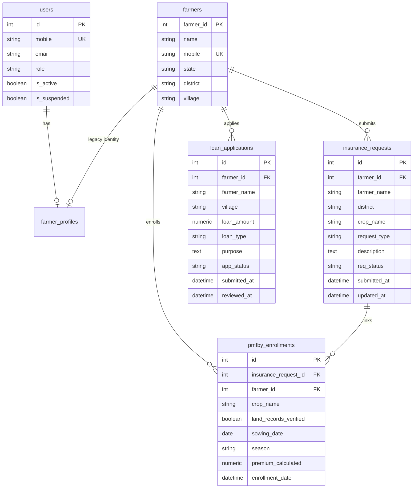

# PROMPT 8 — INITIAL REPOSITORY AUDIT REPORT
**Project:** BhoomiBandhu — A Trusted Friend for Every Farmer  
**Repository Path:** `E:\BhoomiBandhu_React_Express_APIReady`  
**Date:** 2026-11-03  
**Audit Author:** Senior Full-Stack Engineer, Backend Architect & Security Specialist  

---

## 1. Executive Summary

This audit assesses the existing state of Insurance and Loan Administration workflows and Farmer Financial History features across both backend (FastAPI/SQLAlchemy) and frontend (React/Vite).

The repository already contains functional baseline endpoints for insurance creation, loan application, admin listing/status updates, and farmer history retrieval. However, several critical features and enhancements are required to satisfy Prompt 8:
- **Admin Portal:** Lacks search capabilities, granular status statistics (under review/processing, approved, rejected, PMFBY counts), and application detail view modals (with PMFBY enrollment linkage and applicant contact details).
- **Admin APIs:** Missing detail endpoints (`GET /api/admin/insurance-requests/{id}` and `GET /api/admin/loan-applications/{id}`), search parameter support on list endpoints, and dedicated insurance/loan statistics breakdowns.
- **Farmer Dashboard:** Contains separate Insurance and Loans tabs, but lacks an integrated **Financial History Summary** card section, detailed application view, and PMFBY linkage display.
- **Database Schema:** Strict database constraints restrict allowable status strings. Neither table has document upload or rejection note persistence columns.

---

## 2. Responses to Specific Audit Questions

### 1. Whether insurance application creation already works?
**YES.** `POST /api/insurance-requests` in `backend/app/routers/insurance.py` is functional. It validates inputs, upserts the `Farmer` record via mobile number, creates an `InsuranceRequest`, and sets `req_status="pending"`.

### 2. Whether PMFBY enrollment creation already works?
**YES.** In `backend/app/routers/insurance.py` (lines 71–78), if `request_type == "New Insurance Enrollment"`, a linked `PmfbyEnrollment` row is automatically inserted with `land_records_verified=False`.

### 3. Whether loan application creation already works?
**YES.** `POST /api/loan-applications` in `backend/app/routers/loans.py` accepts loan applications, validates amount > 0, links to the farmer via `upsert_farmer`, and sets `app_status="pending"`.

### 4. Whether admin APIs already support listing and reviewing applications?
**PARTIALLY.**
- `GET /api/admin/insurance-requests` exists with pagination and status filtering, but lacks search filtering by application ID, farmer name, crop, or district.
- `GET /api/admin/loan-applications` exists with pagination and status filtering, but lacks search filtering by application ID, farmer name, or village.
- **Neither endpoint provides a single-record detail route** (`GET /api/admin/insurance-requests/{id}` or `GET /api/admin/loan-applications/{id}`).

### 5. Whether application status updates are already implemented?
**YES, BUT WITH LIMITATIONS.**
- `PATCH /api/admin/insurance-requests/{request_id}/status` enforces valid transitions (`pending` → `processing`/`approved`/`rejected`; `processing` → `approved`/`rejected`; `approved` → `paid`).
- `PATCH /api/admin/loan-applications/{application_id}/status` enforces valid transitions (`pending` → `under_review`/`approved`/`rejected`; `under_review` → `approved`/`rejected`) and updates `reviewed_at`.
- **Limitation:** The database models `InsuranceRequest` and `LoanApplication` do **not** have columns for storing rejection reasons or review notes. Notes submitted in requests are logged to the Python application logger (`bhoomibandhu.admin`) but are not persisted in the relational database.

### 6. Whether farmer identity is correctly linked to insurance and loan records?
**YES.**
- `InsuranceRequest.farmer_id` is a foreign key to `farmers.farmer_id`.
- `LoanApplication.farmer_id` is a foreign key to `farmers.farmer_id`.
- `PmfbyEnrollment.farmer_id` is a foreign key to `farmers.farmer_id`.
- Authenticated `User` accounts link to `Farmer` via `FarmerProfile.legacy_farmer_id`.
- `get_current_farmer_id()` dependency reliably resolves `user.id` → `FarmerProfile.legacy_farmer_id`.

### 7. Whether existing records can be displayed using authenticated farmer identity?
**YES.** `backend/app/routers/farmers.py` provides:
- `GET /api/farmers/me/insurance`
- `GET /api/farmers/me/loans`
- Both use `get_current_farmer_id` and query strictly where `farmer_id == farmer_id`.

### 8. Whether existing frontend pages are using real APIs or hardcoded/mock data?
**REAL APIS.**
- `AdminPortalPage.jsx` calls `authFetch` to `/api/admin/insurance-requests` and `/api/admin/loan-applications`.
- `FarmerDashboardPage.jsx` calls `authFetch` to `/api/farmers/me/dashboard`, `/api/farmers/me/insurance`, and `/api/farmers/me/loans`.
- Public submission pages (`InsurancePage.jsx`, `FinancialPage.jsx`) use vanilla JS scripts that submit via `fetch` to `/api/insurance-requests` and `/api/loan-applications`.

### 9. Whether application documents or attachments are supported?
**NO.** None of the models (`InsuranceRequest`, `PmfbyEnrollment`, `LoanApplication`) have document, attachment, or URL columns. No file upload storage or attachment handling exists in the backend.

### 10. Whether any database constraints restrict application status transitions?
**YES.** The following CHECK constraints exist:
- `insurance_requests_chk_1`: `request_type IN ('New Insurance Enrollment', 'Crop Loss Claim')`
- `insurance_requests_chk_2`: `req_status IN ('pending', 'processing', 'approved', 'rejected', 'paid')`
- `loan_applications_chk_1`: `loan_type IN ('Crop Loan', 'Equipment Loan', 'Irrigation Loan', 'Dairy / Livestock Loan')`
- `loan_applications_chk_2`: `app_status IN ('pending', 'under_review', 'approved', 'rejected')`
- `pmfby_enrollments_chk_1`: `season IN ('Kharif', 'Rabi', 'Zaid')`

---

## 3. Existing vs Missing Implementations

| Area | Existing Implementation | Missing Implementation / Gaps |
| :--- | :--- | :--- |
| **Admin Insurance** | - Stats in `/api/admin/stats` - Paginated listing by status - Status PATCH with transition validation | - Dedicated `/api/admin/insurance/stats` with PMFBY & status breakdown - Search by ID, farmer name, crop, district - Detail endpoint `GET /api/admin/insurance-requests/{id}` - Detail modal in Admin Portal showing PMFBY data & farmer contact |
| **Admin Loans** | - Stats in `/api/admin/stats` - Paginated listing by status - Status PATCH with transition validation | - Dedicated `/api/admin/loans/stats` breakdown - Search by ID, farmer name, village - Detail endpoint `GET /api/admin/loan-applications/{id}` - Detail modal in Admin Portal with full applicant data |
| **Farmer Financial History** | - Dashboard counts in `/api/farmers/me/dashboard` - Separate insurance & loan lists via `/api/farmers/me/insurance` & `/api/farmers/me/loans` | - Consolidated financial history overview endpoint `GET /api/farmers/me/financial-history` - Summary cards in Farmer Dashboard for quick financial status breakdown - Enriched item view with PMFBY enrollment status |

---

## 4. Existing Database Models & Relationships

---

## 5. Security Vulnerabilities & Integrity Considerations

1. **Information Disclosure in Admin APIs:** Admin list endpoints currently do not return farmer phone numbers, which protects privacy. If phone numbers are provided in detail views, they must only be accessible to authenticated admins (`require_roles("admin")`).
2. **Cross-Farmer ID Spoofing:** Farmer endpoints must **never** take `farmer_id` from query parameters or request bodies. All queries must resolve `current_user` → `FarmerProfile.legacy_farmer_id`.
3. **Invalid Status Transitions:** Enforced on both backend (FastAPI HTTPException) and frontend (options list in modal) to prevent database CheckConstraint violations.
4. **Rejection Notes Persistence:** The schema has no column for rejection notes. Admin status update requests accept an optional `notes` field which is audit-logged to standard logging, preventing silent database schema errors.

---

## 6. Proposed Implementation Plan & Files for Modification

### Backend Enhancements:
1. `backend/app/schemas/admin_schemas.py`:
   - Add `AdminInsuranceDetailResponse` (includes farmer mobile, state, PMFBY enrollment details).
   - Add `AdminLoanDetailResponse` (includes farmer mobile, state, purpose, reviewed_at).
   - Add `AdminInsuranceStatsResponse` and `AdminLoanStatsResponse`.
2. `backend/app/schemas/portal_schemas.py`:
   - Add `FarmerFinancialHistoryResponse` with consolidated summary metrics and unified history.
3. `backend/app/routers/admin.py`:
   - Add `search` query parameter to `GET /api/admin/insurance-requests`.
   - Add `GET /api/admin/insurance-requests/{id}`.
   - Add `GET /api/admin/insurance-stats`.
   - Add `search` query parameter to `GET /api/admin/loan-applications`.
   - Add `GET /api/admin/loan-applications/{id}`.
   - Add `GET /api/admin/loan-stats`.
4. `backend/app/routers/farmers.py`:
   - Add `GET /api/farmers/me/financial-history` providing summary cards and financial activity records.
5. `backend/tests/test_insurance_loan_admin.py`:
   - Add comprehensive backend unit & integration tests covering admin insurance & loan listing, search, detail view, status update, farmer financial history isolation, and non-admin denial.

### Frontend Enhancements:
1. `client/src/pages/portals/AdminPortalPage.jsx`:
   - Add search input to InsuranceSection.
   - Add search input to LoansSection.
   - Add "View Details" action with modal showing complete application data, farmer details, and PMFBY linkage.
2. `client/src/pages/portals/FarmerDashboardPage.jsx`:
   - Add Financial History summary metrics card section (Total, Pending, Approved Insurance & Loans).
   - Add search/filter capabilities to My Crop Insurance and My Loans tabs.
3. `client/tests/frontend_financial_admin.test.mjs`:
   - Unit tests covering financial history calculation, status label mapping, search filters, and payload formatting.

---

## 7. Migration Requirements

**NONE.** The implementation will strictly leverage the existing SQLAlchemy models and database tables (`farmers`, `insurance_requests`, `pmfby_enrollments`, `loan_applications`, `users`, `farmer_profiles`). No database schema changes, Alembic migrations, or database init scripts are required or permitted.

