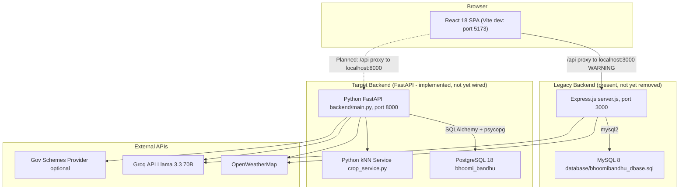

# BhoomiBandhu
## A Trusted Friend for Every Farmer

BhoomiBandhu is a farmer-focused full-stack platform that brings agricultural services together
in one application — crop advice, government schemes, crop insurance, storage booking, financial
assistance, mental-health support, and AI-powered recommendations.

> **Architecture Status (Phase 0 — October 2026)**
> The repository is mid-migration from a legacy Node.js/Express + MySQL stack to the target
> Python/FastAPI + PostgreSQL stack. The FastAPI backend now implements all primary API routes
> and the Python ML service. The Vite proxy and startup scripts still point to the legacy Express
> server. **Do not assume the migration is complete.** See [MIGRATION_STATUS.md](./MIGRATION_STATUS.md)
> and the Architecture section below for the verified current state.

---

## Table of Contents

1. [Project Overview](#1-project-overview)
2. [Project Objectives](#2-project-objectives)
3. [Feature Status](#3-feature-status)
4. [Current Architecture](#4-current-architecture)
5. [Target Architecture](#5-target-architecture)
6. [Technology Stack](#6-technology-stack)
7. [Architecture Diagram](#7-architecture-diagram)
8. [Repository Structure](#8-repository-structure)
9. [Prerequisites](#9-prerequisites)
10. [Installation](#10-installation)
11. [Environment Configuration](#11-environment-configuration)
12. [Running the Application](#12-running-the-application)
13. [Database Setup](#13-database-setup)
14. [API Documentation](#14-api-documentation)
15. [Testing](#15-testing)
16. [Known Limitations](#16-known-limitations)
17. [Team and Responsibilities](#17-team-and-responsibilities)
18. [Phase Roadmap](#18-phase-roadmap)
19. [Contribution Guidelines](#19-contribution-guidelines)
20. [Security Notes](#20-security-notes)
21. [License](#21-license)

---

## 1. Project Overview

Indian farmers face fragmented access to government programmes, financial services, storage
infrastructure, crop insurance, and mental-health support. BhoomiBandhu centralises these
services in a single web application with an AI-powered crop advisor and a confidential
support request system.

---

## 2. Project Objectives

- Farmer registration, authentication, and personalised dashboard.
- Government scheme catalogue and automated eligibility checking.
- Agricultural loan information and application submission.
- PMFBY crop insurance enrolment and crop-loss claim submission.
- Warehouse and cold-storage discovery, availability, and booking.
- Real-time weather information for crop planning.
- Python-based ML crop prediction and smart farming recommendations.
- Confidential mental-health support and psychiatrist workflow.
- Support tickets and administrative workflows.
- Role-specific portals and access control.

---

## 3. Feature Status

| Feature | Backend | Frontend | Overall Status |
|---|---|---|---|
| Landing page and navigation | N/A | Functional | **Implemented — Not Yet Verified on FastAPI** |
| Farmer profile upsert (`/api/farmers`) | FastAPI | Hybrid React+DOM legacy | **Implemented — Not Yet Verified** |
| Government schemes catalogue | FastAPI | Pure React (SchemesPage) | **Implemented — Not Yet Verified** |
| External schemes proxy | FastAPI | Pure React | **Implemented — Not Yet Verified** |
| Scheme eligibility check | FastAPI | DOM legacy (financial.js) | **Implemented — Not Yet Verified** |
| Crop insurance request (submit) | FastAPI | Hybrid React+DOM legacy | **Implemented — Not Yet Verified** |
| Insurance / PMFBY enrolment record | FastAPI | Hybrid React+DOM legacy | **Implemented — Not Yet Verified** |
| Insurance status lookup | FastAPI | DOM legacy (status-tracking.js) | **Implemented — Not Yet Verified** |
| PMFBY enrolment info page | N/A | Static informational | **In Progress (static only)** |
| Claim filing info page | N/A | Static informational | **In Progress (static only)** |
| Risk awareness info page | N/A | Static informational | **In Progress (static only)** |
| Loan application | FastAPI | DOM legacy (financial.js) | **Implemented — Not Yet Verified** |
| Storage facilities listing | FastAPI | DOM legacy (storage.js) | **Implemented — Not Yet Verified** |
| Storage booking | FastAPI | DOM legacy (storage.js) | **Implemented — Not Yet Verified** |
| Storage booking history | FastAPI | DOM legacy (storage.js) | **Implemented — Not Yet Verified** |
| Crop catalogue (`/api/crops`) | FastAPI | via ML advisor | **Implemented — Not Yet Verified** |
| ML crop prediction (Python kNN) | FastAPI (crop_service.py) | Hybrid React+DOM legacy | **Implemented — Not Yet Verified** |
| Weather proxy (OpenWeatherMap) | FastAPI | DOM legacy (ml-crop-advisor.js) | **Implemented — Not Yet Verified** |
| AI advisor (Groq / Llama) | FastAPI | DOM legacy (gemini-advisor.js) | **Implemented — Not Yet Verified** |
| Mental-health request submission | FastAPI | DOM legacy (mental-health.js) | **Implemented — Not Yet Verified** |
| Authentication and login | **Not Started** | **Not Started** | **Not Started** |
| Role-based portals and dashboards | **Not Started** | **Not Started** | **Not Started** |
| Farmer profile dashboard and history | **Not Started** | **Not Started** | **Not Started** |
| Psychiatrist onboarding and workflow | **Not Started** | **Not Started** | **Not Started** |
| Mental-health request history view | **Not Started** | **Not Started** | **Not Started** |
| Support tickets and admin workflow | **Not Started** | **Not Started** | **Not Started** |
| Insurance review and claims admin | **Not Started** | **Not Started** | **Not Started** |
| Warehouse-owner registration | **Not Started** | **Not Started** | **Not Started** |
| Frontend React modernisation (hooks) | **Not Started** | **In Progress** | **In Progress** |

Status key:
- *Implemented — Not Yet Verified* = code exists and compiles, but has not been tested end-to-end through the running FastAPI + PostgreSQL stack.
- *In Progress* = partially implemented.
- *Not Started* = no implementation found.

---

## 4. Current Architecture

The application currently has **two coexisting backends**:

| Layer | Legacy (still present) | Current FastAPI (target) |
|---|---|---|
| Backend runtime | Node.js / Express (`server.js`) | Python / FastAPI (`backend/main.py`) |
| Database | MySQL 8 (`database/bhoomibandhu_dbase.sql`) | PostgreSQL (`bhoomi_bandhu` database) |
| API port | 3000 | 8000 (uvicorn default) |
| ORM / driver | `mysql2` | SQLAlchemy 2 + psycopg 3 |
| ML service | JavaScript kNN in browser | Python kNN in `backend/app/services/crop_service.py` |
| External proxies | Express handlers | FastAPI + httpx |

**The Vite development proxy currently forwards `/api` to `http://localhost:3000` (Express).**
Until `client/vite.config.js` is updated to point to `http://localhost:8000`, the frontend
still hits Express even when FastAPI is running. This is the primary integration blocker.

---

## 5. Target Architecture

```
React (Vite) --/api proxy--> Python FastAPI (port 8000)
                                     |
                               PostgreSQL DB
                                (bhoomi_bandhu)
                                     |
                         +-----------|-------------+
                    SQLAlchemy ORM           Python kNN service
                    (11 tables)              (crop_service.py)
```

Final dependencies (target):

- **Frontend:** React 18, Vite 6, React Router 6
- **Backend:** Python 3.12, FastAPI, Uvicorn
- **Database:** PostgreSQL 18
- **ML:** Python kNN service (pure-Python, no scikit-learn required)
- **External APIs:** OpenWeatherMap, Groq (Llama 3.3 70B), optional gov-schemes provider

---

## 6. Technology Stack

### Active dependencies (installed and in use)

| Category | Package | Version | Notes |
|---|---|---|---|
| Frontend runtime | React | 18.3.1 | |
| Frontend routing | react-router-dom | 6.28.0 | |
| Build tool | Vite + @vitejs/plugin-react | 6.0.5 / 4.3.4 | |
| Legacy backend | Express | 4.19.2 | Still proxied by Vite; not yet removed |
| Legacy DB driver | mysql2 | 3.24.6 | Still required by Express |
| Python web framework | FastAPI | 0.143.3 | |
| Python ASGI server | Uvicorn | 0.54.0 | |
| Python DB driver | psycopg / psycopg-binary | 3.3.6 | |
| Python ORM | SQLAlchemy | 2.1.5 | Synchronous engine |
| Python validation | Pydantic | 2.14.1 | |
| Python HTTP client | httpx | installed | Used in weather, AI, external-schemes routers |
| Python env | python-dotenv | 1.2.4 | |

### Missing / configuration gaps

| Item | Required for | Action needed |
|---|---|---|
| `GROQ_API_KEY` in `backend/.env` | AI advisor (`/api/gemini`) | Set key in `backend/.env` |

Note: The ML crop prediction service (`crop_service.py`) uses a pure-Python kNN
implementation with no dependency on `scikit-learn` or `numpy`. Earlier audits noted these
as missing — they are not required for the current implementation.

---

## 7. Architecture Diagram



Legend: Express/MySQL = legacy (present but being replaced). FastAPI/PostgreSQL = target stack.
WARNING: The Vite proxy currently routes to Express, not FastAPI.

---

## 8. Repository Structure

```
BhoomiBandhu_React_Express_APIReady/
+-- backend/                          # Python FastAPI backend (target)
|   +-- .env                          # Backend secrets (gitignored) - PostgreSQL + API keys
|   +-- .venv/                        # Python virtual environment (gitignored)
|   +-- main.py                       # FastAPI application entry point
|   +-- test_db.py                    # PostgreSQL connectivity test
|   +-- app/
|       +-- core/
|       |   +-- config.py             # Environment variable loading (DB, API keys)
|       |   +-- database.py           # SQLAlchemy engine, session, Base
|       +-- models/
|       |   +-- models.py             # SQLAlchemy ORM models (11 tables)
|       +-- schemas/
|       |   +-- schemas.py            # Pydantic request/response schemas
|       +-- routers/                  # FastAPI route handlers (12 routers)
|       |   +-- health.py             # GET /api/health
|       |   +-- catalogues.py         # GET /api/crops, GET /api/government-schemes
|       |   +-- farmers.py            # POST /api/farmers
|       |   +-- insurance.py          # POST/GET /api/insurance-requests
|       |   +-- loans.py              # POST /api/loan-applications
|       |   +-- mental_health.py      # POST /api/mental-health-requests
|       |   +-- schemes.py            # POST /api/scheme-eligibility-checks
|       |   +-- storage.py            # GET/POST /api/storage-facilities, /api/storage-bookings
|       |   +-- predictions.py        # POST /api/crop-predictions (calls Python kNN)
|       |   +-- weather.py            # GET /api/weather (OpenWeatherMap proxy)
|       |   +-- ai_chat.py            # POST /api/gemini (Groq proxy)
|       |   +-- external_schemes.py   # GET /api/external-government-schemes
|       +-- services/
|       |   +-- crop_service.py       # Pure-Python kNN crop recommendation (120 samples)
|       |   +-- farmer_service.py     # Farmer upsert, mobile normalisation utilities
|       +-- scripts/
|           +-- init_db.py            # Create all PostgreSQL tables (SQLAlchemy DDL)
|           +-- seed_db.py            # Insert reference data (crops, schemes, facilities)
|           +-- test_endpoints.py     # Integration test suite (all 12 routers)
|           +-- cleanup_test_records.py # Remove test data above seed baseline
+-- client/                           # React frontend
|   +-- index.html                    # Vite HTML entry point
|   +-- vite.config.js                # Vite config -- proxy /api -> localhost:3000 (WARNING)
|   +-- src/
|       +-- main.jsx                  # React bootstrap
|       +-- App.jsx                   # React Router routes (12 routes)
|       +-- styles.css                # Global styles and CSS variables
|       +-- pages/                    # 12 React page components (JSX)
|       |   +-- IndexPage.jsx
|       |   +-- StoragePage.jsx
|       |   +-- InsurancePage.jsx
|       |   +-- SchemesPage.jsx       # Pure React (no legacy script)
|       |   +-- FinancialPage.jsx
|       |   +-- MlCropAdvisorPage.jsx # ML advisor + Gemini AI chat (primary ML UI)
|       |   +-- GeminiAdvisorPage.jsx
|       |   +-- MentalHealthPage.jsx
|       |   +-- StatusTrackingPage.jsx
|       |   +-- PmfbyEnrollmentPage.jsx  # Static informational
|       |   +-- ClaimFilingPage.jsx      # Static informational
|       |   +-- RiskAwarenessPage.jsx    # Static informational
|       +-- legacy/                   # DOM-imperative JS modules (to be migrated)
|       +-- pageStyles/               # Per-page CSS modules
+-- database/
|   +-- bhoomibandhu_dbase.sql        # Legacy MySQL schema + seed data (reference only)
+-- server.js                         # Legacy Express backend (16 endpoints, MySQL)
+-- package.json                      # Node.js scripts and dependencies
+-- .env.example                      # Root env template (MySQL vars - needs updating)
+-- .gitignore
+-- LICENSE                           # MIT - Copyright 2026 Pranav Dhiman
+-- START.bat                         # Windows launcher (Express only - needs updating)
+-- MIGRATION_STATUS.md               # Detailed migration audit and status
+-- README.md                         # This file
```

---

## 9. Prerequisites

### For FastAPI backend (target - recommended path)

- **Python 3.12+** with a virtual environment manager
- **PostgreSQL 18** - create a database named `bhoomi_bandhu`

### For Express backend (legacy - still functional)

- **Node.js 18+**
- **MySQL 8.x** with the `bhoomi_bandhu` database schema imported

### External API keys (optional but needed for full functionality)

- **OpenWeatherMap** - `OPENWEATHER_API_KEY` (free tier at openweathermap.org)
- **Groq** - `GROQ_API_KEY` (free tier at console.groq.com)

---

## 10. Installation

### FastAPI backend setup

```bash
cd backend
python -m venv .venv

# Windows
.venv\Scripts\activate

# macOS / Linux
source .venv/bin/activate

pip install fastapi uvicorn[standard] sqlalchemy psycopg psycopg-binary pydantic python-dotenv httpx
```

### Node.js / React setup (required for frontend and legacy Express)

```bash
# From project root
npm install
```

---

## 11. Environment Configuration

### Backend (`backend/.env`)

Create `backend/.env` with the following variables. Do **not** commit this file.

```env
# PostgreSQL connection
DB_HOST=localhost
DB_PORT=5432
DB_NAME=bhoomi_bandhu
DB_USER=postgres
DB_PASSWORD=your_postgres_password_here

# OpenWeatherMap (optional - required for weather and ML advisor)
OPENWEATHER_API_KEY=your_openweathermap_key_here

# Groq AI advisor (optional - required for /api/gemini)
GROQ_API_KEY=your_groq_key_here

# External government schemes API (optional)
GOV_SCHEMES_API_URL=
GOV_SCHEMES_API_KEY=
GOV_SCHEMES_API_KEY_HEADER=Authorization
GOV_SCHEMES_API_KEY_PREFIX=Bearer
```

### Root `.env` (legacy Express only)

Copy `.env.example` to `.env` in the project root and set your MySQL credentials.
Required only when running the legacy Express backend.

```bash
cp .env.example .env
```

---

## 12. Running the Application

**Current state:** The Vite dev-server proxy routes `/api` to Express on port 3000, not
FastAPI. Instructions are provided for both paths.

### Option A - Express + React (legacy, currently wired to frontend)

```bash
npm run dev
```

- Frontend (Vite): http://localhost:5173
- Express API: http://localhost:3000
- Health check: http://localhost:3000/api/health

Requires MySQL running and root `.env` configured.

### Option B - FastAPI + React (target, not yet wired to frontend)

```bash
# Terminal 1: start FastAPI
cd backend
.venv\Scripts\activate
uvicorn main:app --reload --port 8000

# Terminal 2: start React (Vite)
npm run dev:client
```

- FastAPI: http://localhost:8000
- Interactive API docs: http://localhost:8000/docs
- Health check: http://localhost:8000/api/health
- Frontend (Vite): http://localhost:5173 -- note: frontend still calls Express at 3000

To wire the frontend to FastAPI, update `client/vite.config.js` line 10:
```js
// From:
server: { port: 5173, proxy: { '/api': 'http://localhost:3000' } }
// To:
server: { port: 5173, proxy: { '/api': 'http://localhost:8000' } }
```

### Production build (Express-served)

```bash
npm run build
npm start
```

Serves the compiled React app from `client/dist` at http://localhost:3000.

---

## 13. Database Setup

### PostgreSQL (FastAPI - target)

```bash
# Ensure PostgreSQL is running and the database exists:
# createdb -U postgres bhoomi_bandhu

cd backend
.venv\Scripts\activate

# Create all 11 tables
python -m app.scripts.init_db

# Insert reference seed data
python -m app.scripts.seed_db

# Verify connectivity
python test_db.py
```

Expected post-seed row counts: 9 crops, 6 farmers, 3 government schemes, 16 storage
facilities, plus sample rows in the transactional tables.

### MySQL (Express - legacy)

```bash
mysql -u root -p < database/bhoomibandhu_dbase.sql
```

Warning: the SQL script drops and recreates tables. Back up any existing data first.

---

## 14. API Documentation

FastAPI generates interactive API docs automatically:

- **Swagger UI:** http://localhost:8000/docs
- **ReDoc:** http://localhost:8000/redoc

### Implemented FastAPI endpoints

| Method | Path | Description |
|---|---|---|
| GET | /api/health | Database ping and API key readiness |
| GET | /api/crops | Crop catalogue |
| GET | /api/government-schemes | Active government schemes |
| GET | /api/external-government-schemes | External provider proxy (optional) |
| POST | /api/farmers | Create or update farmer profile |
| POST | /api/insurance-requests | Submit insurance/PMFBY request |
| GET | /api/insurance-requests?mobile= | Lookup requests by mobile |
| POST | /api/loan-applications | Submit loan application |
| POST | /api/mental-health-requests | Submit confidential support request |
| POST | /api/scheme-eligibility-checks | Log eligibility check result |
| GET | /api/storage-facilities?state= | List available storage facilities |
| POST | /api/storage-bookings | Create storage booking |
| GET | /api/storage-bookings?mobile= | Lookup bookings by mobile |
| POST | /api/crop-predictions | Save prediction; triggers Python kNN if ML fields absent |
| GET | /api/weather?city= | OpenWeatherMap proxy |
| POST | /api/gemini | Groq AI agricultural advisor proxy |

For a detailed route reference including request/response shapes see MIGRATION_STATUS.md.

---

## 15. Testing

### Database connectivity

```bash
cd backend
python test_db.py
```

### FastAPI integration tests

```bash
cd backend
python -m app.scripts.test_endpoints
```

The suite writes to the live database then removes rows above the seed baseline.
Do not run against a production database.

### Known test gaps

- No automated frontend tests (no Jest, Vitest, Cypress, or Playwright).
- No pytest harness; `test_endpoints.py` is a standalone script.
- No CI/CD pipeline configured.
- End-to-end test results have not been independently verified as part of this audit.

---

## 16. Known Limitations

1. **Vite proxy is wired to Express, not FastAPI** - the primary integration blocker.
   See `client/vite.config.js` line 10. Owner: Yuvraj (Phase 8 / wiring task).
2. **No authentication or session management** - all endpoints are publicly accessible.
   Phase 1 deliverable (Pranav).
3. **Frontend uses DOM-imperative legacy scripts** - pages except SchemesPage use
   `client/src/legacy/*.js` for form handling, bypassing React state.
   Phase 8 deliverable (Yuvraj).
4. **`backend/.env` missing `GROQ_API_KEY`** - AI advisor returns 503 until set.
5. **No overbooking prevention** - storage booking does not decrement `available_space_tons`.
   Phase 4 deliverable (Himanshu).
6. **`START.bat` only starts Express** - needs updating for FastAPI workflow. Phase 10.
7. **Root `.env.example` documents only MySQL vars** - PostgreSQL template needs adding.
8. **Standalone AI Crop Predictor page removed** - `AiCropPredictorPage.jsx` and the
   `/ai-crop-predictor` route no longer exist. `MlCropAdvisorPage.jsx` at `/ml-crop-advisor`
   is the single ML crop-prediction UI. This is the approved direction.
9. **No psychiatrist registration or case-management models** - mental-health workflow
   stores farmer requests only; psychiatrist-side features are unbuilt. Phase 6 (Nora).
10. **No admin dashboard or support-ticket tables** - Phase 7 deliverables (Sagar).

---

## 17. Team and Responsibilities

| Member | Role | Primary Phases | Key Areas |
|---|---|---|---|
| Pranav (Team Lead) | Architecture, Security | 0, 1, 2, 9, 10 | Auth, roles, security review, integration coordination, production readiness |
| Himanshu | Storage and Warehouse | 2, 4, 9 | Warehouse owner registration, storage listings, booking lifecycle, overbooking prevention |
| Nora | Mental Health and Psychiatrist | 2, 6, 9 | Mental-health request history, psychiatrist onboarding, appointments, consent, privacy |
| Sagar | Insurance, Support and Admin | 2, 5, 7, 9 | Insurance review, claims admin, support tickets, admin workflows |
| Yuvraj | React, Farmer UX and QA | 2, 3, 8, 9, 10 | Frontend modernisation, farmer dashboard, regression testing, deployment docs |

---

## 18. Phase Roadmap

| Phase | Title | Lead | Status |
|---|---|---|---|
| 0 | Architecture Audit and Data Safety | Pranav | **In Progress** |
| 1 | Authentication and Authorisation | Pranav | **Not Started** |
| 2 | Role-Based Portal Shells | Pranav (coord) | **Not Started** |
| 3 | Farmer Profile and History | Yuvraj | **Not Started** |
| 4 | Storage and Warehouse | Himanshu | **Not Started** |
| 5 | Insurance | Sagar | **Not Started** |
| 6 | Mental Health and Psychiatrist | Nora | **Not Started** |
| 7 | Support and Administration | Sagar | **Not Started** |
| 8 | React Modernisation | Yuvraj | **Not Started** |
| 9 | End-to-End, Security and Regression Testing | Pranav (coord) | **Not Started** |
| 10 | Production Readiness and Deployment | Pranav (coord) | **Not Started** |

For detailed phase objectives, prerequisites, acceptance criteria, and blockers see
MIGRATION_STATUS.md Section 7.

---

## 19. Contribution Guidelines

1. Never commit `.env`, `backend/.env`, or any file containing real secrets.
2. Treat `database/bhoomibandhu_dbase.sql` as a read-only reference; do not run it against PostgreSQL.
3. Do not modify SQLAlchemy models, database schema, or migrations without coordinating with Pranav.
4. Create a feature branch for each task. Use pull requests; do not push directly to main.
5. Do not run `npm run build` unless testing a production path; use `npm run dev` during development.
6. Do not run destructive scripts (seed_db.py, init_db.py, cleanup_test_records.py) against shared or production data.
7. Keep all API keys in server-side environment files. Never place keys in React source or VITE_-prefixed variables.
8. Before resolving a merge conflict in a documentation file, read both versions and preserve accurate content from each.
9. Update MIGRATION_STATUS.md when a feature moves from Not Started to any other status.

---

## 20. Security Notes

- No authentication is currently enforced on any endpoint. All FastAPI and Express routes
  are publicly accessible. Phase 1 will address this.
- All API keys must remain in server-side `.env` files and must never appear in React source
  code, browser-accessible files, or version control.
- The `.gitignore` excludes `.env`, `.env.*`, and `backend/.env`.
- CORS is currently configured with `allow_origins=["*"]` in FastAPI. This must be tightened
  to specific origins before production deployment.
- The `database/bhoomibandhu_dbase.sql` file contains sample (non-real) data only.
- Role-based access control is planned for Phase 1 / Phase 2 but does not yet exist.

---

## 21. License

MIT License - Copyright (c) 2026 Pranav Dhiman.
See LICENSE for full terms.
