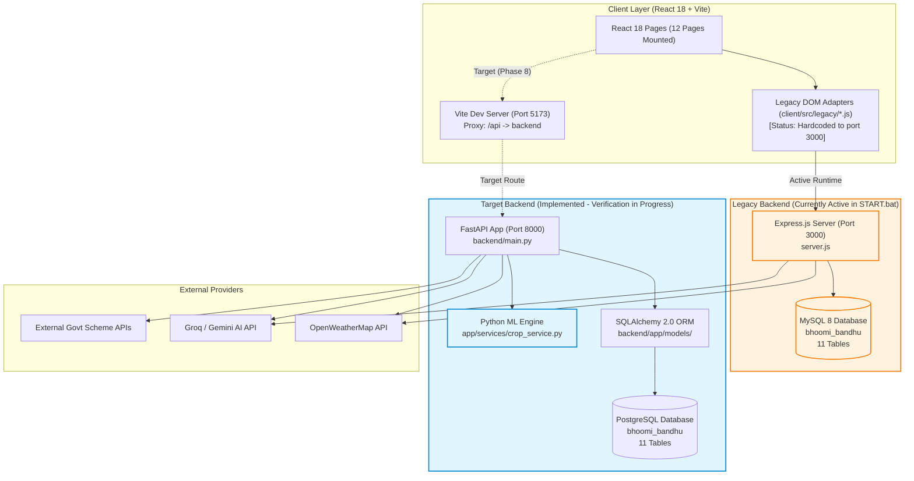

# BhoomiBandhu — Architecture & System Design Record

**Project:** BhoomiBandhu  
**Tagline:** A Trusted Friend for Every Farmer  
**Document Status:** Approved Baseline & Architecture Record (Phase 0 Audit)  
**Date:** October 18, 2026  
**Auditor / Team Lead:** Pranav (Lead & Security)  

---

## 1. Executive Summary & Architectural Direction

BhoomiBandhu is a unified, farmer-centric agricultural services and support platform. The platform is currently in transition between a dual-backend prototype state and a standardized production architecture.

### Target Architecture (Approved Baseline)
- **Frontend:** React 18 SPA built with Vite, React Router v6, controlled React state, and centralized API client.
- **Backend:** Python 3.12+ with **FastAPI** as the single authoritative application REST API server.
- **Database:** **PostgreSQL 16+** managed via SQLAlchemy ORM models with versioned Alembic migrations.
- **AI/ML Engine:** Python-based agronomic intelligence (ML Crop Recommendation engine and AI assistant proxy).
- **External Integrations:** Weather data via OpenWeatherMap API; external Government Schemes via authenticated proxy.

### Current Transition State
The repository currently contains both the legacy Express.js + MySQL runtime and an implemented but unverified FastAPI + PostgreSQL backend. The React client currently runs in a hybrid mode using legacy DOM-script bridges (`client/src/legacy/*.js`) that direct API traffic to `http://localhost:3000` (Express). 

FastAPI routers and SQLAlchemy models already exist in `backend/app/`, fully matching the Express data contracts. During the upcoming phases (Phases 1–3), FastAPI + PostgreSQL will become the sole running backend, and Express + MySQL will be retired.

---

## 2. System Architecture & Component Diagram

The following Mermaid diagram outlines the verified components, request flows, and clear distinction between current active paths and planned components:



---

## 3. Frontend-to-Backend Request Flow & API Routing

### Current Flow (Observed Evidence)
1. The developer executes `npm run dev` or `START.bat`.
2. `START.bat` builds the Vite bundle (`client/dist`) and boots Express on port 3000 (`node server.js`).
3. Express serves static production assets from `client/dist` and handles `/api/*` endpoints.
4. When running in Vite development mode (`port 5173`), `client/vite.config.js` proxies `/api` to `http://localhost:3000`.
5. However, seven legacy JavaScript scripts (`financial.js`, `insurance.js`, `mental-health.js`, `ml-crop-advisor.js`, `schemes.js`, `status-tracking.js`, `storage.js`) contain the pattern:
   ```javascript
   const API_BASE = window.location.port === "3000" ? "" : "http://localhost:3000";
   ```
   This bypasses the Vite proxy and hardcodes calls directly to Express on port 3000.

### Target Flow (Phase 1 & Phase 8)
1. The client uses relative URL paths (`/api/...`) via an idiomatic React API client (Axios or fetch wrapper).
2. During local development, Vite proxies `/api` to FastAPI running on `http://localhost:8000`.
3. In production, FastAPI either serves the compiled static React build from `client/dist` or runs behind a reverse proxy (e.g., NGINX/Caddy).
4. All requests pass through FastAPI dependency injection for authentication, validation, and role enforcement.

---

## 4. Authentication, Authorization & Security Boundaries

### Current State (Critical Vulnerabilities Identified in Audit)
1. **No Authentication Layer:** Neither Express nor FastAPI currently has authentication middleware, session cookies, JWT verification, or password hashing.
2. **Insecure Record Access (IDOR via Phone Number):** Private farmer records (insurance requests, storage bookings) are queried using `?mobile=<phone_number>`. A user possessing a farmer's phone number can enumerate and view private booking history.
3. **Unauthenticated Mutations:** `POST /api/farmers` and multiple workflow forms upsert farmer details purely by mobile number. An unauthorized party can mutate profile data of another farmer.
4. **Permissive CORS:** Both Express (`app.use(cors())`) and FastAPI (`allow_origins=["*"]`) allow all origins without restrictions.
5. **Lack of Rate Limiting:** Public endpoints proxying billable LLM APIs (`/api/gemini`) and weather services (`/api/weather`) have no throttling or abuse prevention.

### Target Security Architecture (Phase 1 & Phase 2 Baseline)
1. **Identity & Authentication:**
   - Dedicated `users` table linked to `farmers`, `warehouse_owners`, `psychiatrists`, `support_agents`, and `admins`.
   - Password hashing via Argon2id or bcrypt.
   - Session tokens or HttpOnly, Secure, SameSite cookies with CSRF protection.
2. **Role-Based Access Control (RBAC):**
   - Five distinct roles:
     - `farmer`: Owns profile, views own bookings, insurance requests, mental health request status.
     - `warehouse_owner`: Manages owned facilities, approves/rejects bookings. Pending verification upon signup.
     - `psychiatrist`: Accesses assigned cases with explicit consent. Pending verification upon signup.
     - `support_agent`: Resolves assigned support tickets; zero access to clinical psychiatric records.
     - `admin`: Platform administration, audit log inspection, professional verification.
3. **Resource Ownership Checks:**
   - FastAPI dependency `get_current_user` extracts identity.
   - Querying farmer data requires `current_user.id == target_user.id` or elevated staff role.
4. **CORS & Rate Limiting:**
   - Strict origin allowlist (`localhost:5173`, approved staging/production domains).
   - Rate limiting on `/api/gemini`, `/api/weather`, and public submission endpoints.

---

## 5. Database Architecture & Migration Approach

### Database Comparison
| Attribute | Legacy Database | Target Database |
|---|---|---|
| **RDBMS** | MySQL 8.x | PostgreSQL 16+ |
| **Driver / Connection** | `mysql2/promise` (Node.js) | `psycopg` (v3) / SQLAlchemy 2.0 (Python) |
| **Schema Definition** | `database/bhoomibandhu_dbase.sql` | `backend/app/models/models.py` |
| **Data Types** | `TINYINT(1)` for bool, `AUTO_INCREMENT` | `BOOLEAN`, PostgreSQL `SERIAL` / identity |
| **Initialization Method** | Destructive raw SQL dump (`DROP TABLE IF EXISTS`) | Safe SQLAlchemy `Base.metadata.create_all()` / Alembic |
| **Migration Tooling** | None (manual SQL) | Alembic (planned for Phase 2) |

### Migration & Data Safety Rules
1. **Never Run Raw SQL Dump in Production:** `database/bhoomibandhu_dbase.sql` contains `DROP TABLE IF EXISTS`, which destroys live data.
2. **Never Assert Exact Production Counts:** Automated test scripts (`test_endpoints.py`) previously asserted an exact database row count of 62. Tests must execute against an isolated test database with fixture tagging.
3. **Seed Data Separation:** Reference catalogues (`crops`, `government_schemes`, `storage_facilities`) must be seeded independently from transactional user records.

---

## 6. AI & Machine Learning Architecture

### Crop Recommendation Engine
- **Original Implementation:** 120 agronomic records hardcoded into client JavaScript (`ml-crop-advisor.js`), computing a k-Nearest Neighbors (kNN) algorithm in the farmer's browser using normalized Euclidean distance.
- **Python ML Implementation:** `backend/app/services/crop_service.py` ports the exact 120-row dataset and kNN feature normalisation (rainfall, temperature, soil type, season, irrigation) to Python. Exposes `POST /api/crop-prediction/predict` via `backend/app/routers/predictions.py`.
- **Approved Direction:** The ML Crop Advisor is the primary, single crop advisory interface. The standalone `ai-crop-predictor.html` prototype from early static mockups is retired and superseded by the React ML Crop Advisor.

### Conversational AI Assistant
- Exposes `POST /api/gemini` which connects to Groq / Gemini API using server-side keys (`GROQ_API_KEY`).
- Keys are kept strictly on the backend and are never exposed to client code.

---

## 7. Architectural Decisions & Open Questions

| Decision ID | Context / Question | Current State | Recommendation / Action Required |
|---|---|---|---|
| **ADR-01** | Backend Source of Truth | Dual backends exist (Express in `server.js` and FastAPI in `backend/`). | Standardize on **FastAPI + PostgreSQL** as the sole backend. Deprecate Express. |
| **ADR-02** | Session vs. JWT Token | Authentication has not yet been implemented. | Pranav to specify whether HttpOnly cookie sessions or bearer JWTs are preferred for Phase 1. |
| **ADR-03** | Python Package Management | `backend/` has no `requirements.txt` or `pyproject.toml`. | Add a pinned `requirements.txt` / `pyproject.toml` containing FastAPI, psycopg, SQLAlchemy, httpx, scikit-learn. |
| **ADR-04** | Alembic Setup | Migrations currently use direct `create_all()`. | Initialize Alembic in `backend/` for repeatable, versioned database schema migrations. |
