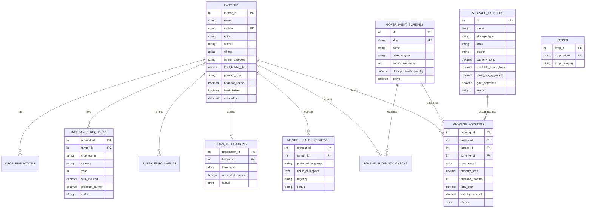

# BhoomiBandhu — Database Architecture & Schema Specification

**Document Status:** Verified Baseline (Phase 0 Audit)  
**Date:** October 18, 2026  
**Auditor / Team Lead:** Pranav (Lead & Security)  

This document details the database architecture of BhoomiBandhu, contrasting the legacy MySQL structure (`database/bhoomibandhu_dbase.sql`) with the target PostgreSQL SQLAlchemy models (`backend/app/models/models.py`).

---

## 1. Database Overview & Current State

- **Target Database:** PostgreSQL 16+ (Database name: `bhoomi_bandhu`).
- **Target ORM:** SQLAlchemy 2.0 with `psycopg` (v3).
- **Legacy Database:** MySQL 8.x with `mysql2` driver.
- **Table Count:** 11 core tables verified in both MySQL and PostgreSQL model definitions.
- **Migration Status:** SQLAlchemy models in `backend/app/models/models.py` accurately reflect the 11 tables. Initial PostgreSQL initialization script exists at `backend/app/scripts/init_db.py`. Versioned Alembic migrations are planned for Phase 2.

> [!WARNING]
> **Data Safety Critical Notice:** The legacy script `database/bhoomibandhu_dbase.sql` contains `DROP TABLE IF EXISTS` statements. It must **never** be executed against a staging or production database containing live data.

---

## 2. Entity Relationship Diagram (ERD)



---

## 3. Verified Tables & Schema Details

### 3.1 `crops` (Reference Catalogue)
- **Primary Key:** `crop_id` (SERIAL / Integer)
- **Columns:**
  - `crop_name`: VARCHAR(100), UNIQUE, NOT NULL
  - `crop_category`: VARCHAR(50), NULL (e.g., Cereal, Pulse, Cash Crop)
- **Seeded Rows:** 9 verified crop reference entries (Wheat, Rice, Maize, Cotton, Sugarcane, Millets, Groundnut, Pulses, Mustard).

### 3.2 `farmers` (Core Identity & Demographics)
- **Primary Key:** `farmer_id` (SERIAL / Integer)
- **Columns:**
  - `name`: VARCHAR(100), NOT NULL
  - `mobile`: VARCHAR(15), UNIQUE, NOT NULL, INDEXED
  - `state`: VARCHAR(50), NOT NULL, INDEXED
  - `email`: VARCHAR(150), NULL
  - `district`: VARCHAR(80), NULL
  - `village`: VARCHAR(100), NULL
  - `farmer_category`: VARCHAR(20), CHECK (`farmer_category IN ('small', 'marginal', 'large')`)
  - `land_holding_ha`: NUMERIC(6, 2), NULL
  - `primary_crop`: VARCHAR(80), NULL
  - `aadhaar_linked`: BOOLEAN, DEFAULT FALSE
  - `bank_linked`: BOOLEAN, DEFAULT FALSE
  - `profile_photo_url`: VARCHAR(255), NULL
  - `created_at`: TIMESTAMPTZ, DEFAULT CURRENT_TIMESTAMP
  - `updated_at`: TIMESTAMPTZ, DEFAULT CURRENT_TIMESTAMP

### 3.3 `government_schemes` (Reference Catalogue)
- **Primary Key:** `id` (SERIAL / Integer)
- **Columns:**
  - `slug`: VARCHAR(50), UNIQUE, NOT NULL
  - `name`: VARCHAR(150), NOT NULL
  - `scheme_type`: VARCHAR(20), CHECK (`scheme_type IN ('central', 'state')`)
  - `benefit_summary`: TEXT, NULL
  - `storage_benefit_per_kg`: NUMERIC(5, 2), DEFAULT 0.00
  - `active`: BOOLEAN, DEFAULT TRUE
  - `created_at`: TIMESTAMPTZ, DEFAULT CURRENT_TIMESTAMP

### 3.4 `storage_facilities` (Warehouses & Cold Storages)
- **Primary Key:** `id` (SERIAL / Integer)
- **Columns:**
  - `name`: VARCHAR(150), NOT NULL
  - `storage_type`: VARCHAR(30), INDEXED (e.g., "Cold Storage", "Warehouse")
  - `location_text`: VARCHAR(200), NULL
  - `state`: VARCHAR(60), INDEXED
  - `district`: VARCHAR(80), NULL
  - `distance_km`: NUMERIC(5, 1), NULL
  - `capacity_tons`: NUMERIC(10, 2), NULL
  - `available_space_tons`: NUMERIC(10, 2), NULL
  - `price_per_kg_month`: NUMERIC(5, 2), NOT NULL
  - `mode`: VARCHAR(10), NULL
  - `temperature_range`: VARCHAR(30), NULL
  - `suitable_crops`: TEXT, NULL
  - `facilities`: TEXT, NULL
  - `scheme_support`: TEXT, NULL
  - `rating`: NUMERIC(3, 1), NULL
  - `review_count`: INTEGER, DEFAULT 0
  - `govt_approved`: BOOLEAN, DEFAULT FALSE
  - `status`: VARCHAR(20), DEFAULT 'available', INDEXED

### 3.5 `storage_bookings` (Storage Reservations)
- **Primary Key:** `booking_id` (SERIAL / Integer)
- **Foreign Keys:**
  - `facility_id` -> `storage_facilities.id` (ON DELETE RESTRICT)
  - `farmer_id` -> `farmers.farmer_id` (ON DELETE RESTRICT)
  - `scheme_id` -> `government_schemes.id` (ON DELETE SET NULL)
- **Columns:**
  - `crop_stored`: VARCHAR(80), NOT NULL
  - `quantity_tons`: NUMERIC(10, 2), NOT NULL
  - `duration_months`: INTEGER, NOT NULL
  - `start_date`: DATE, NULL
  - `total_cost`: NUMERIC(10, 2), NOT NULL
  - `subsidy_amount`: NUMERIC(10, 2), DEFAULT 0.00
  - `farmer_payable`: NUMERIC(10, 2), NOT NULL
  - `status`: VARCHAR(20), DEFAULT 'booked' (CHECK `status IN ('booked', 'active', 'completed', 'cancelled')`)

### 3.6 `insurance_requests` (PMFBY & Crop Insurance Inquiries)
- **Primary Key:** `request_id` (SERIAL / Integer)
- **Foreign Keys:** `farmer_id` -> `farmers.farmer_id`
- **Columns:** `crop_name`, `season`, `year`, `sum_insured`, `premium_farmer`, `area_hectares`, `status` (`'submitted'`, `'verified'`, `'approved'`, `'rejected'`).

### 3.7 `mental_health_requests` (Wellbeing Inquiries)
- **Primary Key:** `request_id` (SERIAL / Integer)
- **Foreign Keys:** `farmer_id` -> `farmers.farmer_id`
- **Columns:** `preferred_language`, `issue_description` (TEXT), `urgency` (`'low'`, `'medium'`, `'high'`), `status` (`'pending_assignment'`, `'assigned'`, `'resolved'`).

### 3.8 `loan_applications` (Financial Credit Inquiries)
- **Primary Key:** `application_id` (SERIAL / Integer)
- **Foreign Keys:** `farmer_id` -> `farmers.farmer_id`
- **Columns:** `loan_type`, `requested_amount`, `bank_preference`, `status`.

### 3.9 `scheme_eligibility_checks`
- **Primary Key:** `check_id` (SERIAL / Integer)
- **Foreign Keys:** `farmer_id`, `scheme_id`
- **Columns:** `land_holding_ha`, `annual_income`, `category_selected`, `is_eligible`, `notes`.

### 3.10 `crop_predictions`
- **Primary Key:** `prediction_id` (SERIAL / Integer)
- **Foreign Keys:** `farmer_id`
- **Columns:** `rainfall_mm`, `temperature_c`, `soil_type`, `season`, `irrigation`, `recommended_crop`, `confidence_pct`, `yield_level`, `risk_level`.

### 3.11 `pmfby_enrollments`
- **Primary Key:** `enrollment_id` (SERIAL / Integer)
- **Foreign Keys:** `farmer_id`
- **Columns:** `application_no`, `crop_name`, `insurance_company`, `sum_insured`, `premium_paid`, `status`.

---

## 4. Planned Schema Extensions for Phase 1 & 2

The current schema lacks account credentials and role support. The following tables and alterations are planned for Phase 1:

1. **`users` Table (Planned - Phase 1):**
   ```sql
   CREATE TABLE users (
       user_id SERIAL PRIMARY KEY,
       email VARCHAR(150) UNIQUE,
       phone VARCHAR(15) UNIQUE NOT NULL,
       hashed_password VARCHAR(255) NOT NULL,
       role VARCHAR(30) NOT NULL CHECK (role IN ('farmer', 'warehouse_owner', 'psychiatrist', 'support_agent', 'admin')),
       is_active BOOLEAN DEFAULT TRUE,
       is_verified BOOLEAN DEFAULT FALSE,
       created_at TIMESTAMPTZ DEFAULT CURRENT_TIMESTAMP,
       updated_at TIMESTAMPTZ DEFAULT CURRENT_TIMESTAMP
   );
   ```
2. **Farmer Account Linkage (Planned - Phase 1):**
   Add `user_id INTEGER UNIQUE REFERENCES users(user_id) ON DELETE CASCADE` to the `farmers` table.
3. **Audit Log Table (Planned - Phase 7):**
   Track administrative operations and verification actions.
